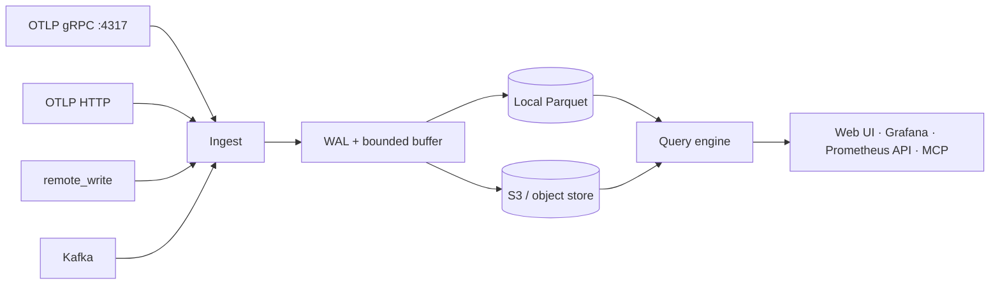

<!--
  Parqtel organization profile — shown at github.com/parqtel
  Brand assets live in profile/assets/ (hero, logos, icon).
-->

<div align="center">

<picture>
  <source media="(prefers-color-scheme: dark)" srcset="profile/assets/hero.svg">
  <source media="(prefers-color-scheme: light)" srcset="profile/assets/hero.svg">
  
</picture>

<h1>Parqtel</h1>

<p>
  <strong>OpenTelemetry metrics, logs and traces in compressed Parquet.</strong><br>
  One Rust binary. PromQL-compatible queries. Optional S3-compatible storage.
</p>

<p>
  <a href="https://github.com/parqtel/parqtel-oss"></a>
  <a href="https://github.com/parqtel/parqtel-oss/blob/main/LICENSE"></a>
  <a href="https://parqtel.github.io"></a>
  <a href="https://ghcr.io/parqtel/parqtel-oss"></a>
</p>

<p>
  <a href="https://github.com/parqtel/parqtel-oss"><b>Get started</b></a> •
  <a href="https://parqtel.github.io">Documentation</a> •
  <a href="https://github.com/parqtel/parqtel-oss/blob/main/CONTRIBUTING.md">Contributing</a> •
  <a href="https://github.com/parqtel/parqtel-oss/discussions">Community</a>
</p>

</div>

---

## What is Parqtel?

Parqtel is a single-binary observability backend written in Rust. It ingests
OpenTelemetry metrics, logs and traces, stores them as compressed Apache
Parquet, and serves PromQL-compatible queries, log and trace search, pipelines,
dashboards, alerting, a web console and MCP — from one static binary.

Local disk is the default. An S3-compatible bucket with a shared catalog is
optional. No JVM, no sidecars, no shell in the container.

**Why teams pick Parqtel:**

- **25× cheaper storage** — columnar Parquet + Zstd versus Prometheus TSDB.
- **Under 20 MB binary** — scratch-based container, bounded memory, runs at the edge.
- **Drop-in compatibility** — Prometheus API, Grafana SimpleJSON, OTLP, `remote_write`.
- **Durable by default** — write-ahead log before acknowledgement, crash-safe replay.
- **AI-native** — 7 MCP servers give LLMs direct, scoped access to telemetry for automated incident response.

## When to use Parqtel?

Parqtel is a great choice if you:

- Want to unify metrics, logs and traces in a single, low-footprint system.
- Care about data sovereignty and want absolute control over your telemetry.
- Are concerned about the rising cost of your current observability platform.
- Need local-first telemetry on constrained or edge hardware (IoT, ARM).
- Want LLMs to query telemetry directly for faster root-cause analysis.

## Get started

```bash
# Homebrew (Linux & macOS)
brew tap parqtel/tap
brew install parqtel-oss
parqtel serve

# Docker
docker run -p 8080:8080 -v parqtel_data:/var/lib/parqtel ghcr.io/parqtel/parqtel-oss:0.3.1

# From source
git clone https://github.com/parqtel/parqtel-oss.git
cd parqtel-oss && cargo build --release
./target/release/parqtel serve
```

Full walkthrough in the [documentation](https://parqtel.github.io).

## Featured repositories

<a href="https://github.com/parqtel/parqtel-oss"><picture><source media="(prefers-color-scheme: dark)" srcset="https://github-readme-stats.vercel.app/api/pin/?username=parqtel&repo=parqtel-oss&show_icons=true&hide_border=true&theme=dark"><source media="(prefers-color-scheme: light), (prefers-color-scheme: no-preference)" srcset="https://github-readme-stats.vercel.app/api/pin/?username=parqtel&repo=parqtel-oss&show_icons=true&hide_border=true"></picture></a>
<a href="https://github.com/parqtel/parqtel-web"><picture><source media="(prefers-color-scheme: dark)" srcset="https://github-readme-stats.vercel.app/api/pin/?username=parqtel&repo=parqtel-web&show_icons=true&hide_border=true&theme=dark"><source media="(prefers-color-scheme: light), (prefers-color-scheme: no-preference)" srcset="https://github-readme-stats.vercel.app/api/pin/?username=parqtel&repo=parqtel-web&show_icons=true&hide_border=true"></picture></a>
<a href="https://github.com/parqtel/parqtel.github.io"><picture><source media="(prefers-color-scheme: dark)" srcset="https://github-readme-stats.vercel.app/api/pin/?username=parqtel&repo=parqtel.github.io&show_icons=true&hide_border=true&theme=dark"><source media="(prefers-color-scheme: light), (prefers-color-scheme: no-preference)" srcset="https://github-readme-stats.vercel.app/api/pin/?username=parqtel&repo=parqtel.github.io&show_icons=true&hide_border=true"></picture></a>

| Repository | What it is |
|------------|------------|
| [**parqtel-oss**](https://github.com/parqtel/parqtel-oss) | The core engine — ingest, store, query, alert, visualize, MCP. |
| [**parqtel-web**](https://github.com/parqtel/parqtel-web) | The marketing website (Astro + Tailwind). |
| [**parqtel.github.io**](https://github.com/parqtel/parqtel.github.io) | The public documentation site. |

## Architecture at a glance



## Community

- **Docs:** [parqtel.github.io](https://parqtel.github.io)
- **Contributing:** [CONTRIBUTING.md](https://github.com/parqtel/parqtel-oss/blob/main/CONTRIBUTING.md)
- **Code of conduct:** [CODE_OF_CONDUCT.md](https://github.com/parqtel/parqtel-oss/blob/main/CODE_OF_CONDUCT.md)
- **Security:** [SECURITY.md](https://github.com/parqtel/parqtel-oss/blob/main/SECURITY.md)
- **Support:** [SUPPORT.md](https://github.com/parqtel/parqtel-oss/blob/main/SUPPORT.md)

<div align="center">
  <sub>Open source. Enterprise ready. Built for what's next.</sub>
</div>